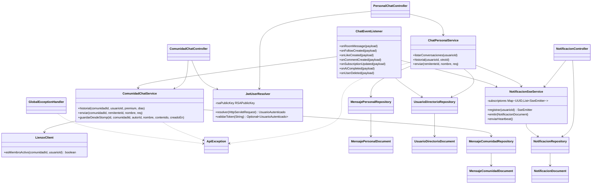

# artagram-chat

Microservicio de Chat Personal, Chat de Comunidad y Notificaciones Server-Sent Events (SSE) para ArtaGram.

## Tecnologías
- Java 21, Spring Boot 3.3.4
- Spring Data MongoDB (base de datos `db_chat`)
- Spring AMQP (RabbitMQ: consume eventos de notificaciones `chat.*`)
- Server-Sent Events (SSE) para stream de notificaciones en tiempo real
- WebClient con CircuitBreaker para consultar membresía a `artagram-lienzo`

## Endpoints
- `GET /api/mensajes/conversaciones`
- `GET /api/mensajes/{otroUsuarioId}`
- `POST /api/mensajes`
- `GET /api/comunidades/{comunidadId}/chat`
- `POST /api/comunidades/{comunidadId}/chat`
- `GET /api/notificaciones`
- `GET /api/notificaciones/stream` (SSE)
- `PUT /api/notificaciones/{id}/leida`
- `PUT /api/notificaciones/leer-todas`

## Variables de Entorno
Ver `.env.example`.

## Diseño y Arquitectura

### Descripción

`artagram-chat` sigue una arquitectura en capas clásica (`controller` → `service` → `domain`/Mongo), con tres flujos funcionales independientes que comparten infraestructura:

- **Chat personal** (`ChatPersonalService`): mensajería 1:1, con un directorio local de usuarios (`UsuarioDirectorioDocument`) para resolver nombres sin llamar a otro servicio.
- **Chat de comunidad** (`ComunidadChatService`): persiste tanto lo escrito por REST como lo recibido por STOMP desde `artagram-lienzo` (`guardarDesdeStomp`, idempotente por `existsById`), y valida membresía contra `LienzoClient`.
- **Notificaciones** (`NotificacionSseService`): un *hub* en memoria de `SseEmitter` por usuario; cualquier flujo (mensajes directos, o los 6 tipos de evento que procesa `ChatEventListener`) empuja notificaciones sin conocer los detalles de SSE.

### Análisis SOLID

- **SRP — violación concreta en `JwtUserResolver`**: la clase mezcla tres responsabilidades que en otros servicios del mismo workspace (p. ej. `artagram-canvas`) están separadas en `JwtService` (carga de llave + validación) y `JwtUserResolver` (extracción desde el request): acá una sola clase carga el PEM desde disco, verifica la firma RS256 y además resuelve el principal desde headers `X-User-*` como atajo cuando el gateway ya validó. Difícil de testear la validación JWT de forma aislada.
- **SRP — tensión en `ChatEventListener`**: siete `@RabbitListener` no relacionados (mensajes de sala, follows, likes, comentarios, suscripción, IA, borrado de usuario) en una sola clase. Cada handler es simple y independiente, pero la clase tiene siete razones distintas para cambiar. Aceptable a esta escala; en una próxima iteración podría dividirse por dominio (p. ej. un listener por tipo de evento, o un `NotificationDispatcher` con *strategy* por `tipo`).
- **DIP — violación en `ComunidadChatService`/`ChatEventListener`**: dependen directamente de `LienzoClient`, una clase concreta atada a `RestTemplate`, no de una interfaz (`MembershipChecker` o similar). Cambiar el transporte (gRPC, llamada local si `community` se migra) obliga a tocar el cliente y, potencialmente, sus consumidores.
- **OCP — bien resuelto en `NotificacionSseService`**: nuevas fuentes de notificación solo necesitan construir un `NotificacionDocument` y llamar a `emitir(...)`; no hay que modificar el servicio SSE para añadir un tipo de notificación nuevo (eso ya pasó 6 veces en `ChatEventListener` sin tocar `NotificacionSseService`).
- **LSP/ISP**: no aplican de forma relevante — no hay jerarquías de herencia de dominio ni interfaces anchas que algún cliente implemente parcialmente.
- **Nota aparte**: el README original afirmaba "WebClient con CircuitBreaker" para `LienzoClient`, pero el código usa `RestTemplate` bloqueante con un `catch` que devuelve `true` (acceso permitido) ante cualquier fallo — no hay disyuntor real, solo *fail-open*. Correcto para desarrollo local, pero es un riesgo de disponibilidad/seguridad en producción (una caída prolongada de la membresía deja el chat de comunidad abierto a cualquiera) que vale la pena resolver antes de producción.

### Extensibilidad

- Nuevo tipo de notificación → agregar un `@RabbitListener` en `ChatEventListener` (o una clase nueva) que llame a `NotificacionSseService.emitir(...)`; cero cambios en el resto del sistema.
- Nuevo canal de chat (p. ej. chat de equipo) → replicar el patrón `Controller` + `Service` + `Document`/`Repository` ya usado por personal/comunidad; `JwtUserResolver` y `GlobalExceptionHandler` se reutilizan sin cambios.
- El directorio local de usuarios (`UsuarioDirectorioRepository`) permite resolver nombres sin acoplarse a `artagram-users`, a costa de datos potencialmente desactualizados — es una proyección, igual que `UsuarioProyeccion` en `artagram-canvas`.

### Preparación para AWS

- **Datastore**: `db_chat` (MongoDB) → **Amazon DocumentDB** (compatible con el driver de Mongo sin cambios de código) o **MongoDB Atlas** si se prefiere multi-cloud. Revisar que el driver soporte el modo de replica set que exponga DocumentDB (algunas operaciones de agregación difieren).
- **Secretos**: la llave pública JWT se carga desde un archivo montado (`app.jwt.public-key-path`) o desde una variable con el PEM inline (`app.jwt.public-key-pem`). En AWS, inyectar el PEM completo como secreto de **Secrets Manager** (o **SSM Parameter Store**, SecureString) hacia esa variable de entorno evita depender de un volumen montado — ya hay un *fallback* a variable de entorno en el propio código, listo para usarse así.
- **SSE y balanceo de carga**: `NotificacionSseService` mantiene el estado de suscriptores **en memoria del proceso**. Detrás de un *Application Load Balancer* con más de una tarea/instancia, un usuario puede conectar su SSE a la tarea A y un evento (p. ej. `like.created`) puede procesarse en la tarea B, que no tiene su `SseEmitter` — la notificación no llega. Opciones: (a) *sticky sessions* a nivel de ALB (atan al usuario a una tarea, reduce elasticidad), o (b) la misma estrategia que ya usa `RealtimeBroadcaster` en `artagram-canvas` (relay vía Redis Pub/Sub entre instancias) adaptada a SSE. Esto es un bloqueante real para escalar horizontalmente este servicio en AWS, no solo un detalle.
- **RabbitMQ**: `chat.*` son colas propias con *dead-letter* — migran directo a **Amazon MQ for RabbitMQ** sin cambiar el código (mismo protocolo AMQP 0.9.1); alternativa nativa de AWS sería SNS/SQS, pero exige reescribir el binding por tipo de evento.
- **Cómputo**: sin estado persistente en disco (más allá del PEM) y con *health checks* de Actuator ya expuestos → apto para **ECS Fargate** o **EKS** detrás del ALB, siempre que se resuelva el punto de SSE multi-instancia arriba.

## Descripción del servicio

`artagram-chat` es el microservicio responsable de la mensajería persistente de ArtaGram (chat personal 1 a 1 y chat de comunidad) y del centro de notificaciones de la plataforma, usando MongoDB (`db_chat`) como almacenamiento de documentos. Existe como servicio separado porque este dominio tiene un perfil de datos y de escritura/lectura muy distinto al resto de ArtaGram (historiales de conversación que crecen sin límite, mensajes efímeros de alta frecuencia, notificaciones push en vivo) y porque necesita absorber eventos de **todos** los demás servicios (follows, likes, comentarios, suscripciones, IA, borrado de usuarios) sin acoplarlos entre sí: cada servicio solo publica un evento en RabbitMQ y `artagram-chat` decide cómo convertirlo en una notificación persistida y, si corresponde, en un empuje en tiempo real vía Server-Sent Events (SSE). Es importante notar que este servicio **no termina conexiones WebSocket/STOMP**: ese rol lo cumple `artagram-lienzo` (canvas); `artagram-chat` solo consume por RabbitMQ los mensajes que ya se transmitieron en vivo por STOMP (`chat.room.message`, `personal.message.sent`) y actúa como la única fuente de verdad para su persistencia, de forma idempotente. En cuanto a la extracción planeada de notificaciones a un servicio `artagram-notifications` separado, **todavía no se hizo**: `NotificacionController`, `NotificacionSseService` y `NotificacionDocument`/`NotificacionRepository` siguen viviendo dentro de `artagram-chat` hoy, por lo que el chat y las notificaciones continúan desplegándose y escalando como una sola unidad.

## Responsabilidades

- Persistir mensajes de chat personal 1:1 (`MensajePersonalDocument`), calculando una clave de conversación determinística y manteniendo el estado leído/no leído.
- Persistir mensajes de chat de comunidad (`MensajeComunidadDocument`), tanto los enviados por REST como los recibidos vía STOMP desde `artagram-lienzo` a través de RabbitMQ, de forma idempotente (`existsById`).
- Exponer la API REST de conversaciones, historial y envío de mensajes personales y de comunidad, resolviendo el usuario autenticado vía JWT RS256 o vía headers `X-User-*` inyectados por el gateway (`JwtUserResolver`).
- Validar membresía activa en una comunidad contra `artagram-lienzo` (`LienzoClient`) antes de permitir leer o escribir en su chat.
- Mantener un directorio local de usuarios (`UsuarioDirectorioDocument`) para resolver nombres de artista sin llamar a `artagram-users` en cada mensaje, sincronizado por eventos (`subscription.updated`, `user.deleted`).
- Centralizar y persistir notificaciones (`NotificacionDocument`) a partir de 7 tipos de eventos de dominio consumidos por `ChatEventListener` (mensaje directo, nuevo seguidor, like, comentario, suscripción premium, análisis de IA completado, usuario eliminado).
- Transmitir notificaciones en tiempo real por Server-Sent Events (`NotificacionSseService`), con un *heartbeat* programado cada 25s para mantener viva la conexión y limpiar emisores muertos.
- Aplicar límites de historial de chat de comunidad según plan: 30 días (o el parámetro `dias` si es menor) para usuarios no premium, hasta 365 días o ilimitado según `dias` para usuarios premium.
- Exponer métricas (contador `http_errores_5xx_total`) y *health checks* de Spring Actuator para observabilidad.

## Diagrama de clases

```mermaid
classDiagram
    class PersonalChatController {
        +conversaciones(request)
        +historialCon(otroUsuarioId, request)
        +enviar(req, request)
    }
    class ComunidadChatController {
        +historial(comunidadId, dias, request)
        +enviar(comunidadId, req, request)
    }
    class NotificacionController {
        +listar(request)
        +marcarLeida(id, request)
        +stream(request) SseEmitter
    }
    class ChatPersonalService {
        +listarConversaciones(usuarioId)
        +historial(usuarioId, otroId)
        +enviar(remitenteId, remitenteNombre, req)
        +guardarDesdeStomp(id, remitenteId, remitenteNombre, destinatarioId, contenido)
    }
    class ComunidadChatService {
        +historial(comunidadId, usuarioId, premium, dias)
        +enviar(comunidadId, remitenteId, remitenteNombre, req)
        +guardarDesdeStomp(id, comunidadId, autorId, autorNombre, contenido, creadoEn)
    }
    class NotificacionSseService {
        -subscriptores Map~UUID, List~SseEmitter~~
        +registrar(usuarioId) SseEmitter
        +emitir(doc)
        +enviarHeartbeat()
    }
    class ChatEventListener {
        +onRoomMessage(payload)
        +onPersonalMessage(payload)
        +onFollowCreated(payload)
        +onLikeCreated(payload)
        +onCommentCreated(payload)
        +onSubscriptionUpdated(payload)
        +onAiCompleted(payload)
        +onUserDeleted(payload)
    }
    class LienzoClient {
        +esMiembroActivo(comunidadId, usuarioId) boolean
    }
    class JwtUserResolver {
        -rsaPublicKey RSAPublicKey
        +resolver(request) UsuarioAutenticado
        +validarToken(token) Optional~UsuarioAutenticado~
    }
    class ChatRabbitMqConfig
    class ApiException
    class GlobalExceptionHandler
    class ChatDataSeeder

    class MensajePersonalDocument
    class MensajeComunidadDocument
    class NotificacionDocument
    class UsuarioDirectorioDocument
    class MensajePersonalRepository
    class MensajeComunidadRepository
    class NotificacionRepository
    class UsuarioDirectorioRepository

    PersonalChatController --> ChatPersonalService
    PersonalChatController --> JwtUserResolver
    ComunidadChatController --> ComunidadChatService
    ComunidadChatController --> JwtUserResolver
    NotificacionController --> NotificacionSseService
    NotificacionController --> NotificacionRepository
    NotificacionController --> JwtUserResolver

    ChatPersonalService --> MensajePersonalRepository
    ChatPersonalService --> UsuarioDirectorioRepository
    ChatPersonalService --> NotificacionSseService
    ChatPersonalService ..> ApiException

    ComunidadChatService --> MensajeComunidadRepository
    ComunidadChatService --> LienzoClient
    ComunidadChatService ..> ApiException

    ChatEventListener --> ComunidadChatService
    ChatEventListener --> ChatPersonalService
    ChatEventListener --> NotificacionSseService
    ChatEventListener --> UsuarioDirectorioRepository

    NotificacionSseService --> NotificacionRepository
    GlobalExceptionHandler ..> ApiException

    ChatDataSeeder --> UsuarioDirectorioRepository
    ChatDataSeeder --> MensajePersonalRepository
    ChatDataSeeder --> MensajeComunidadRepository
    ChatDataSeeder --> NotificacionRepository

    MensajePersonalRepository --> MensajePersonalDocument
    MensajeComunidadRepository --> MensajeComunidadDocument
    NotificacionRepository --> NotificacionDocument
    UsuarioDirectorioRepository --> UsuarioDirectorioDocument
```

## Atributos de calidad

### Escalabilidad de notificaciones en tiempo real (SSE)

`NotificacionSseService` guarda los `SseEmitter` activos en un `Map<UUID, List<SseEmitter>>` **en memoria del propio proceso**, sin ningún mecanismo de relay entre instancias (a diferencia de `RealtimeBroadcaster` en `artagram-canvas`, que sí usa Redis Pub/Sub). Esto limita severamente la escalabilidad horizontal de este flujo.

- **Fuente**: Un evento de dominio (`like.created`) publicado en RabbitMQ por otro servicio (p. ej. `artagram-canvas`).
- **Estímulo**: El evento llega a `ChatEventListener.onLikeCreated` y debe notificarse en vivo al autor del post afectado.
- **Artefacto**: `NotificacionSseService` (mapa `subscriptores` en memoria).
- **Ambiente**: Producción, con el servicio desplegado en 2 o más instancias (ECS Fargate) detrás de un Application Load Balancer, sin *sticky sessions* ni relay entre instancias.
- **Respuesta**: El usuario destinatario tiene su conexión SSE abierta en la instancia B, pero el evento de RabbitMQ (con balanceo round-robin entre consumidores) se procesa en la instancia A; la instancia A no tiene el `SseEmitter` de ese usuario, así que la notificación en vivo no se entrega (sí queda persistida en `NotificacionDocument` y aparecerá luego vía `GET /api/notificaciones`).
- **Medida de respuesta**: Con una sola instancia, la entrega SSE en vivo es prácticamente 100%; al pasar a 2+ instancias sin relay, la probabilidad de entrega en vivo cae a aproximadamente `1 / n` (siendo `n` el número de instancias), ya que solo se entrega cuando el evento se procesa en la misma instancia donde está el emisor — esto bloquea escalar horizontalmente este servicio sin antes resolverlo con *sticky sessions* o un relay tipo Redis Pub/Sub.

### Disponibilidad del chat de comunidad ante caída de `artagram-lienzo`

`LienzoClient.esMiembroActivo` captura cualquier excepción de red hacia `artagram-lienzo` y responde `true` (acceso permitido) en vez de propagar el error o aplicar un disyuntor real, pese a que el README original describía esto como "WebClient con CircuitBreaker".

- **Fuente**: `artagram-lienzo` (servicio que expone la membresía de comunidades).
- **Estímulo**: El servicio queda caído, lento o no responde (timeout/excepción) al recibir una petición de `GET /internal/communities/{id}/members/{usuarioId}`.
- **Artefacto**: `LienzoClient.esMiembroActivo(comunidadId, usuarioId)`, invocado desde `ComunidadChatService`.
- **Ambiente**: Producción, con `artagram-lienzo` temporalmente no disponible mientras usuarios intentan leer o escribir en el chat de una comunidad.
- **Respuesta**: La excepción se captura en un `catch` genérico que retorna `true`; `ComunidadChatService` interpreta esto como "sí es miembro activo" y deja pasar la operación, es decir, el chat de comunidad queda abierto a cualquier usuario autenticado (no solo a miembros) mientras dure la caída de `artagram-lienzo`.
- **Medida de respuesta**: Disponibilidad percibida del chat de comunidad de prácticamente 100% durante la caída de `artagram-lienzo` (0 peticiones rechazadas por error de dependencia), a costa de 0% de verificación real de membresía durante esa ventana — un *fail-open* que favorece disponibilidad sobre autorización, y que debería revisarse antes de producción.

### Consistencia eventual entre el canal STOMP en vivo y la persistencia en MongoDB

El envío de un mensaje de comunidad se transmite en vivo por STOMP desde `artagram-lienzo` y, en paralelo, se persiste en `artagram-chat` mediante un evento asíncrono de RabbitMQ (`chat.room.message`), por lo que hay una ventana donde el mensaje es visible en tiempo real pero aún no aparece en el historial persistido.

- **Fuente**: Un usuario conectado por WebSocket/STOMP a `artagram-lienzo` que envía un mensaje en el chat de una comunidad.
- **Estímulo**: El mensaje se difunde en vivo a otros miembros conectados por STOMP, y simultáneamente se publica un evento `room.message` en RabbitMQ para que `artagram-chat` lo persista.
- **Artefacto**: `ChatEventListener.onRoomMessage` → `ComunidadChatService.guardarDesdeStomp`.
- **Ambiente**: Operación normal, con RabbitMQ entregando el mensaje con una latencia no nula (ni instantánea) y con posibilidad de reintento/redelivery ante fallos transitorios.
- **Respuesta**: `guardarDesdeStomp` verifica `existsById(id)` antes de guardar, por lo que un reintento o redelivery del mismo mensaje no genera duplicados en `mensajes_comunidad`; sin embargo, durante la ventana entre la difusión STOMP y la persistencia, una consulta a `GET /api/comunidades/{comunidadId}/chat` puede no incluir todavía ese mensaje.
- **Medida de respuesta**: Ventana de inconsistencia típica inferior a 1 segundo bajo operación normal de RabbitMQ (sin reintentos); 0% de mensajes duplicados en el historial persistido incluso ante redelivery de la cola, gracias a la verificación de idempotencia por `id`.
