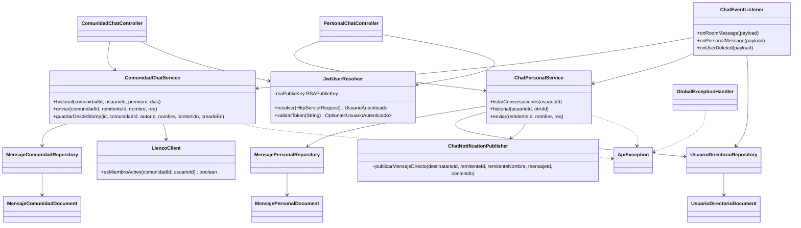

# artagram-chat

Microservicio de Chat Personal, Chat de Comunidad y Notificaciones Server-Sent Events (SSE) para ArtaGram.

## Tecnologías
- Java 21, Spring Boot 3.3.4
- Spring Data MongoDB (base de datos `db_chat`)
- Spring AMQP (RabbitMQ: consume mensajes transmitidos en vivo por STOMP y publica el evento de notificación de mensaje directo hacia `artagram-notifications`)
- WebClient con CircuitBreaker para consultar membresía a `artagram-lienzo`

## Endpoints
- `GET /api/mensajes/conversaciones`
- `GET /api/mensajes/{otroUsuarioId}`
- `POST /api/mensajes`
- `GET /api/comunidades/{comunidadId}/chat`
- `POST /api/comunidades/{comunidadId}/chat`

El centro de notificaciones (REST + SSE) vive en `artagram-notifications`; el gateway enruta `/api/notificaciones/**` directamente ahí.

## Variables de Entorno
Ver `.env.example`.

## Diseño y Arquitectura

### Descripción

`artagram-chat` sigue una arquitectura en capas clásica (`controller` → `service` → `domain`/Mongo), con dos flujos funcionales independientes que comparten infraestructura:

- **Chat personal** (`ChatPersonalService`): mensajería 1:1, con un directorio local de usuarios (`UsuarioDirectorioDocument`) para resolver nombres sin llamar a otro servicio.
- **Chat de comunidad** (`ComunidadChatService`): persiste tanto lo escrito por REST como lo recibido por STOMP desde `artagram-lienzo` (`guardarDesdeStomp`, idempotente por `existsById`), y valida membresía contra `LienzoClient`.

El centro de notificaciones (persistencia + SSE) se migró por completo a `artagram-notifications`: este servicio ya no guarda ni transmite notificaciones propias. Lo único que conserva es `ChatNotificationPublisher`, que publica un evento (`personal.message.notification`) cuando se envía un mensaje directo, para que `artagram-notifications` lo convierta en notificación.

### Análisis SOLID

- **SRP — violación concreta en `JwtUserResolver`**: la clase mezcla tres responsabilidades que en otros servicios del mismo workspace (p. ej. `artagram-canvas`) están separadas en `JwtService` (carga de llave + validación) y `JwtUserResolver` (extracción desde el request): acá una sola clase carga el PEM desde disco, verifica la firma RS256 y además resuelve el principal desde headers `X-User-*` como atajo cuando el gateway ya validó. Difícil de testear la validación JWT de forma aislada.
- **DIP — violación en `ComunidadChatService`/`ChatEventListener`**: dependen directamente de `LienzoClient`, una clase concreta atada a `RestTemplate`, no de una interfaz (`MembershipChecker` o similar). Cambiar el transporte (gRPC, llamada local si `community` se migra) obliga a tocar el cliente y, potencialmente, sus consumidores.
- **LSP/ISP**: no aplican de forma relevante — no hay jerarquías de herencia de dominio ni interfaces anchas que algún cliente implemente parcialmente.
- **Nota aparte**: el README original afirmaba "WebClient con CircuitBreaker" para `LienzoClient`, pero el código usa `RestTemplate` bloqueante con un `catch` que devuelve `true` (acceso permitido) ante cualquier fallo — no hay disyuntor real, solo *fail-open*. Correcto para desarrollo local, pero es un riesgo de disponibilidad/seguridad en producción (una caída prolongada de la membresía deja el chat de comunidad abierto a cualquiera) que vale la pena resolver antes de producción.

### Extensibilidad

- Nuevo canal de chat (p. ej. chat de equipo) → replicar el patrón `Controller` + `Service` + `Document`/`Repository` ya usado por personal/comunidad; `JwtUserResolver` y `GlobalExceptionHandler` se reutilizan sin cambios.
- El directorio local de usuarios (`UsuarioDirectorioRepository`) permite resolver nombres sin acoplarse a `artagram-users`, a costa de datos potencialmente desactualizados — es una proyección, igual que `UsuarioProyeccion` en `artagram-canvas`.
- Nuevo evento de notificación originado en chat → agregar un método en `ChatNotificationPublisher` con su propia routing key; cero cambios en `artagram-notifications` más allá de agregar la cola/listener correspondiente.

### Preparación para AWS

- **Datastore**: `db_chat` (MongoDB) → **Amazon DocumentDB** (compatible con el driver de Mongo sin cambios de código) o **MongoDB Atlas** si se prefiere multi-cloud. Revisar que el driver soporte el modo de replica set que exponga DocumentDB (algunas operaciones de agregación difieren).
- **Secretos**: la llave pública JWT se carga desde un archivo montado (`app.jwt.public-key-path`) o desde una variable con el PEM inline (`app.jwt.public-key-pem`). En AWS, inyectar el PEM completo como secreto de **Secrets Manager** (o **SSM Parameter Store**, SecureString) hacia esa variable de entorno evita depender de un volumen montado — ya hay un *fallback* a variable de entorno en el propio código, listo para usarse así.
- **RabbitMQ**: la publicación de `personal.message.notification` usa el mismo exchange topic `artagram.events` que el resto del workspace — migra directo a **Amazon MQ for RabbitMQ** sin cambiar el código (mismo protocolo AMQP 0.9.1).
- **Cómputo**: sin estado persistente en disco (más allá del PEM) y con *health checks* de Actuator ya expuestos → apto para **ECS Fargate** o **EKS** detrás del ALB. Al no mantener ya ningún estado de SSE en memoria, este servicio escala horizontalmente sin las limitaciones que sí aplican a `artagram-notifications`.

## Descripción del servicio

`artagram-chat` es el microservicio responsable de la mensajería persistente de ArtaGram (chat personal 1 a 1 y chat de comunidad), usando MongoDB (`db_chat`) como almacenamiento de documentos. Existe como servicio separado porque este dominio tiene un perfil de datos y de escritura/lectura muy distinto al resto de ArtaGram (historiales de conversación que crecen sin límite, mensajes efímeros de alta frecuencia). Es importante notar que este servicio **no termina conexiones WebSocket/STOMP**: ese rol lo cumple `artagram-lienzo` (canvas); `artagram-chat` solo consume por RabbitMQ los mensajes que ya se transmitieron en vivo por STOMP (`chat.room.message`, `personal.message.sent`) y actúa como la única fuente de verdad para su persistencia, de forma idempotente. La extracción del centro de notificaciones a `artagram-notifications` **ya se completó**: `NotificacionController`, `NotificacionSseService` y `NotificacionDocument`/`NotificacionRepository` se eliminaron de este servicio. Lo único que queda del lado de chat es `ChatNotificationPublisher`, que publica el evento `personal.message.notification` (consumido por `artagram-notifications` vía el shovel que conecta el vhost `/` con el vhost `notifications`) cuando se envía un mensaje directo — el resto de eventos que antes generaban notificaciones aquí (follows, likes, comentarios, suscripciones, IA) ya los escucha directamente `artagram-notifications`, sin pasar por chat.

## Responsabilidades

- Persistir mensajes de chat personal 1:1 (`MensajePersonalDocument`), calculando una clave de conversación determinística y manteniendo el estado leído/no leído.
- Persistir mensajes de chat de comunidad (`MensajeComunidadDocument`), tanto los enviados por REST como los recibidos vía STOMP desde `artagram-lienzo` a través de RabbitMQ, de forma idempotente (`existsById`).
- Exponer la API REST de conversaciones, historial y envío de mensajes personales y de comunidad, resolviendo el usuario autenticado vía JWT RS256 o vía headers `X-User-*` inyectados por el gateway (`JwtUserResolver`).
- Validar membresía activa en una comunidad contra `artagram-lienzo` (`LienzoClient`) antes de permitir leer o escribir en su chat.
- Mantener un directorio local de usuarios (`UsuarioDirectorioDocument`) para resolver nombres de artista sin llamar a `artagram-users` en cada mensaje, sincronizado por eventos (`user.deleted`).
- Publicar un evento de notificación (`personal.message.notification`, vía `ChatNotificationPublisher`) cuando se envía un mensaje directo, para que `artagram-notifications` lo persista y lo transmita en tiempo real — chat ya no mantiene su propio centro de notificaciones.
- Aplicar límites de historial de chat de comunidad según plan: 30 días (o el parámetro `dias` si es menor) para usuarios no premium, hasta 365 días o ilimitado según `dias` para usuarios premium.
- Exponer métricas (contador `http_errores_5xx_total`) y *health checks* de Spring Actuator para observabilidad.

## Diagrama de clases

```mermaid
classDiagram
    class PersonalChatController {
        +conversaciones(request)
        +historialCon(otroUsuarioId, request)
        +enviar(req, request)
    }
    class ComunidadChatController {
        +historial(comunidadId, dias, request)
        +enviar(comunidadId, req, request)
    }
    class ChatPersonalService {
        +listarConversaciones(usuarioId)
        +historial(usuarioId, otroId)
        +enviar(remitenteId, remitenteNombre, req)
        +guardarDesdeStomp(id, remitenteId, remitenteNombre, destinatarioId, contenido)
    }
    class ComunidadChatService {
        +historial(comunidadId, usuarioId, premium, dias)
        +enviar(comunidadId, remitenteId, remitenteNombre, req)
        +guardarDesdeStomp(id, comunidadId, autorId, autorNombre, contenido, creadoEn)
    }
    class ChatNotificationPublisher {
        +publicarMensajeDirecto(destinatarioId, remitenteId, remitenteNombre, mensajeId, contenido)
    }
    class ChatEventListener {
        +onRoomMessage(payload)
        +onPersonalMessage(payload)
        +onUserDeleted(payload)
    }
    class LienzoClient {
        +esMiembroActivo(comunidadId, usuarioId) boolean
    }
    class JwtUserResolver {
        -rsaPublicKey RSAPublicKey
        +resolver(request) UsuarioAutenticado
        +validarToken(token) Optional~UsuarioAutenticado~
    }
    class ChatRabbitMqConfig
    class ApiException
    class GlobalExceptionHandler
    class ChatDataSeeder

    class MensajePersonalDocument
    class MensajeComunidadDocument
    class UsuarioDirectorioDocument
    class MensajePersonalRepository
    class MensajeComunidadRepository
    class UsuarioDirectorioRepository

    PersonalChatController --> ChatPersonalService
    PersonalChatController --> JwtUserResolver
    ComunidadChatController --> ComunidadChatService
    ComunidadChatController --> JwtUserResolver

    ChatPersonalService --> MensajePersonalRepository
    ChatPersonalService --> UsuarioDirectorioRepository
    ChatPersonalService --> ChatNotificationPublisher
    ChatPersonalService ..> ApiException

    ComunidadChatService --> MensajeComunidadRepository
    ComunidadChatService --> LienzoClient
    ComunidadChatService ..> ApiException

    ChatEventListener --> ComunidadChatService
    ChatEventListener --> ChatPersonalService
    ChatEventListener --> UsuarioDirectorioRepository

    GlobalExceptionHandler ..> ApiException

    ChatDataSeeder --> UsuarioDirectorioRepository
    ChatDataSeeder --> MensajePersonalRepository
    ChatDataSeeder --> MensajeComunidadRepository

    MensajePersonalRepository --> MensajePersonalDocument
    MensajeComunidadRepository --> MensajeComunidadDocument
    UsuarioDirectorioRepository --> UsuarioDirectorioDocument
```

## Atributos de calidad

> La escalabilidad de las notificaciones en tiempo real (SSE en memoria por instancia, sin relay entre nodos) ya no es un atributo de calidad de `artagram-chat`: ese estado se migró por completo a `artagram-notifications`, que documenta ese escenario en su propio README.

### Disponibilidad del chat de comunidad ante caída de `artagram-lienzo`

`LienzoClient.esMiembroActivo` captura cualquier excepción de red hacia `artagram-lienzo` y responde `true` (acceso permitido) en vez de propagar el error o aplicar un disyuntor real, pese a que el README original describía esto como "WebClient con CircuitBreaker".

- **Fuente**: `artagram-lienzo` (servicio que expone la membresía de comunidades).
- **Estímulo**: El servicio queda caído, lento o no responde (timeout/excepción) al recibir una petición de `GET /internal/communities/{id}/members/{usuarioId}`.
- **Artefacto**: `LienzoClient.esMiembroActivo(comunidadId, usuarioId)`, invocado desde `ComunidadChatService`.
- **Ambiente**: Producción, con `artagram-lienzo` temporalmente no disponible mientras usuarios intentan leer o escribir en el chat de una comunidad.
- **Respuesta**: La excepción se captura en un `catch` genérico que retorna `true`; `ComunidadChatService` interpreta esto como "sí es miembro activo" y deja pasar la operación, es decir, el chat de comunidad queda abierto a cualquier usuario autenticado (no solo a miembros) mientras dure la caída de `artagram-lienzo`.
- **Medida de respuesta**: Disponibilidad percibida del chat de comunidad de prácticamente 100% durante la caída de `artagram-lienzo` (0 peticiones rechazadas por error de dependencia), a costa de 0% de verificación real de membresía durante esa ventana — un *fail-open* que favorece disponibilidad sobre autorización, y que debería revisarse antes de producción.

### Consistencia eventual entre el canal STOMP en vivo y la persistencia en MongoDB

El envío de un mensaje de comunidad se transmite en vivo por STOMP desde `artagram-lienzo` y, en paralelo, se persiste en `artagram-chat` mediante un evento asíncrono de RabbitMQ (`chat.room.message`), por lo que hay una ventana donde el mensaje es visible en tiempo real pero aún no aparece en el historial persistido.

- **Fuente**: Un usuario conectado por WebSocket/STOMP a `artagram-lienzo` que envía un mensaje en el chat de una comunidad.
- **Estímulo**: El mensaje se difunde en vivo a otros miembros conectados por STOMP, y simultáneamente se publica un evento `room.message` en RabbitMQ para que `artagram-chat` lo persista.
- **Artefacto**: `ChatEventListener.onRoomMessage` → `ComunidadChatService.guardarDesdeStomp`.
- **Ambiente**: Operación normal, con RabbitMQ entregando el mensaje con una latencia no nula (ni instantánea) y con posibilidad de reintento/redelivery ante fallos transitorios.
- **Respuesta**: `guardarDesdeStomp` verifica `existsById(id)` antes de guardar, por lo que un reintento o redelivery del mismo mensaje no genera duplicados en `mensajes_comunidad`; sin embargo, durante la ventana entre la difusión STOMP y la persistencia, una consulta a `GET /api/comunidades/{comunidadId}/chat` puede no incluir todavía ese mensaje.
- **Medida de respuesta**: Ventana de inconsistencia típica inferior a 1 segundo bajo operación normal de RabbitMQ (sin reintentos); 0% de mensajes duplicados en el historial persistido incluso ante redelivery de la cola, gracias a la verificación de idempotencia por `id`.
